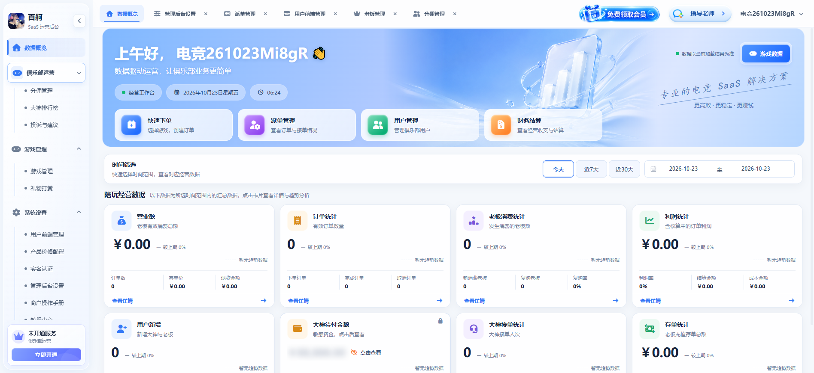

# 百舸（dianjinglm.com）与蠢驴电竞系统对比记录

> 查看时间：2026-10-23 06:22–06:30（Asia/Shanghai）  
> 查看入口：https://www.dianjinglm.com/gp/referral  
> 登录账号：电竞261023Mi8gR（新俱乐部“百舸”，多数业务数据为 0）  
> 说明：这是一个新开的 SaaS 俱乐部账号，页面上的金额/订单为空；以下功能是按界面、字段、按钮、空状态和说明文字记录的产品能力，不代表其真实运营数据。



---

## 一、对方产品定位

从界面看，百舸不是单纯“陪玩派单工具”，而是一套 **多租户电竞俱乐部 SaaS**：

```text
平台方（SaaS）
  └─ 俱乐部/商户（百舸）
       ├─ 老板（客户）账号、余额、存单、VIP、在线下单
       ├─ 大神（陪玩）账号、押金、认证、提现、接单
       ├─ 客服/运营/财务角色
       ├─ 用户端（老板/游客可访问的俱乐部前台）
       └─ 陪玩经营系统 + 账号租赁系统（可切换的业务系统）
```

关键特征：

- 俱乐部有独立 ID、独立用户端链接、产品价格链接
- 有会员/服务有效期、资源上限（产品数、店铺链接数、订单数）
- 可同时选择“陪玩经营系统”和“账号租赁系统”
- 有平台侧“免费领取会员/指导老师/开通服务”的 SaaS 销售入口

---

## 二、对方完整功能地图

### 1. 数据概览

- 经营工作台：问候、日期、当前时间、数据加载说明
- 快捷入口：快速下单、派单管理、用户管理、财务结算
- 时间筛选：今天 / 近 7 天 / 近 30 天 / 自定义日期
- 经营数据卡：
  - 营业额（订单数、客单价、退款金额）
  - 订单统计（下单、完成、取消）
  - 老板消费统计（新消费老板、复购老板、复购率）
  - 利润统计（利润率、结算金额、成本金额）
  - 用户新增
  - 大神待付金额（敏感资金，点击查看）
  - 大神接单统计
  - 存单统计
- 每张卡可点“查看详情”，做趋势/明细下钻
- 数据口径说明、较上期对比、空数据趋势提示

### 2. 派单管理

- 快捷下单
- 日期范围：今天 / 昨天 / 近 7 / 15 / 30 天 / 自定义
- 订单状态页签：全部 / 待接单 / 进行中 / 核算中 / 完成
- 筛选：锁定状态、下单来源、折扣、订单号/游戏编号/群号/组队码/标签
- 工具：查看游戏营业额占比、用户资金充值、订单跟进、订单导出、折扣配置
- 列表字段包含金额、最终状态、来源、折扣等
- 强调“金额与最终订单状态以后端返回结果为准”

### 3. 用户管理

#### 老板管理（客户）

- 老板总数、停用老板、累计消费、余额合计
- 按注册日期、昵称/手机号/ID、状态、标签筛选、排序
- 新增老板、批量导入
- 会员转账
- 订单统计
- 客户是“有账号、有余额、有消费、有标签”的老板，不只是客户资料

#### 大神管理（陪玩）

- 大神总数、今日接单人数、允许登录人数、总押金、实缴押金、累计大神收入
- 认证游戏/等级、登录状态、缴纳方式、排序
- 批量操作
- 押金设定（店铺默认押金 500 元，可单独设置）
- 大神标签
- 大神资料审核
- 大神补款/扣款
- 用户信息、认证游戏、接单数据、账户余额、押金状态、允许登录、登录/注册
- 支持“允许登录”开关，平台可冻结大神登录

#### 大神补扣款

- 办理大神扣款/补款
- 补扣款上限
- 合计金额、累计扣款、累计补款、今日操作笔数
- 按日期、用户、操作人、订单号、类型筛选
- 记录列表可导出
- 账户流水和订单关联留痕

### 4. 财务管理

#### 资金日志

- 资金流水查询

#### 老板存单

- 老板预存/存单管理

#### 财务统计

- 今日收款、今日现金退款、今日净收款
- 收款金额 / 现金退款 / 净收款趋势
- 渠道收支总览：微信、支付宝、企业微信、其他
- 收款渠道占比
- 渠道汇总：收款金额、现金退款、净收款、笔数
- 收支明细：发生时间、收支类型、渠道、金额、老板、订单号、操作人、备注
- 导出数据、查看各渠道明细

#### 提现审核

- 待审核金额/条数（按微信/支付宝/银行卡拆分）
- 已处理通过、已拒绝、手续费合计（已收取/待处理/已返还）
- 按日期、用户、收款类型、状态筛选
- 批量通过、批量拒绝
- 提现单号/金额、用户、真实姓名/收款账号、收款码/方式、拒绝原因、申请时间、审核时间
- 提现方式、提现手续费、提现限制配置
- 导出记录

### 5. 运营管理

#### 操作日志

- 只读审计：订单与用户相关操作
- 匹配记录、操作人、关联订单、关联用户、操作类型统计
- 按操作日期、操作类型、订单编号、用户、操作人筛选
- 记录字段：ID、操作类型、内容、订单编号、用户、操作人、时间
- 明确“操作内容是核心证据，可查看完整记录，但不能修改/删除”

#### 客服业绩

- 客服维度的业绩统计（页面入口存在）

#### VIP 等级

- 6 级会员：初见、白银、黄金、铂金、钻石、黑金
- 经验规则：消费 1 元 = 1 经验；已核算订单和成功打赏计入经验
- 等级名称、经验门槛可配置
- 会员权益说明图上传
- 用户端会员卡预览、升级进度
- 等级列表

#### 分佣管理

- 邀请老板下单获得佣金
- 累计已发佣金、邀请老板数、已绑定（有效）、待核算佣金
- 分佣等级
- 发放统计
- 添加老板并绑定邀请人
- 按老板、邀请人、分佣等级、状态、绑定日期筛选
- 字段：老板信息、邀请人、分佣等级/比例、绑定状态、累计下单金额、累计已发佣金、最近下单时间
- 调级、解绑、重新绑定只影响新订单，历史订单按发布时比例
- 邀请关系留痕

#### 大神排行榜

- 创建排行榜活动，选择榜单和活动时间
- 大神领取订单后自动计榜
- 退款、删单、换人自动修正成绩
- 已结束活动仍会修正
- 可控制大神中心是否展示排行榜
- 活动状态、大神端展示开关

#### 投诉与建议

- 反馈编号、提交人、平台身份、类型、投诉对象、内容摘要、关联订单、提交时间、状态
- 全部类型/状态、搜索、查询、重置
- 公开回复展示给提交人，内部备注仅后台可见
- 仅俱乐部主账号可查看

### 6. 游戏管理

#### 礼物打赏

- 成功打赏金额、商户抽成收入、大神实际到账
- 打赏单号/时间、赠送用户 → 收礼大神、礼物、打赏金额、收益分配、状态/支付方式
- 状态：待支付 / 已完成 / 已关闭 / 到账处理中
- 配置礼物、设置抽成比例
- 支付成功即时到账、不支持退款

### 7. 系统设置

#### 用户前端管理（俱乐部管理）

- 俱乐部概览：Logo、名称、ID、客服名称、资料完善度、访问次数、创建时间
- 编辑资料、更多操作、访问记录
- 产品价格链接、用户端链接，可复制/打开
- 老板在线下单开关
- 客服分配方式：自动分配 / 指定客服
- 俱乐部展示状态开关
- 轮播位管理：老板/游客首页顶部、大神首页顶部、大神广场、礼物打赏页顶部、大神首页底部
- 每个位置最多 5 张图，JPG/PNG，建议 1265×500，≤5MB
- 平台模板轮播、排序、编辑、隐藏/删除限制

#### 产品价格配置

- 用户端价格表实时预览
- 分类管理、产品管理、轮播图管理
- 显示端设置（双端展示）
- 批量导入（需开通会员）
- 分类关联游戏，必须关联游戏才能线下单（当前仅支持陪玩单）
- 排序、子项数

#### 实名认证

- 企业认证：企业名称、统一社会信用代码、营业执照、法定代表人
- 个体工商户认证：名称、统一社会信用代码、营业执照、经营者
- 个人实名认证：真实姓名、身份证、本人手机号、身份核验
- 认证后解锁平台核心功能

#### 管理后台设置

- 俱乐部名称、大神昵称前缀、订单编号前缀、Logo
- 使用系统：陪玩经营系统 / 账号租赁系统（仅控制入口，不代表已付费）
- 当前服务：会员有效期、服务状态
- 资源使用概览：店铺广告产品、店铺链接、订单等上限
- 会员开通入口、使用说明

#### 商户操作手册 / 教程中心

- 面向商户的操作文档和教程

---

## 三、我们系统（蠢驴电竞）现有能力

以仓库现状归纳，不逐个页面重复：

### 1. 组织与角色

- 老板 / 店长（ADMIN）/ 客服（CS）/ 陪玩（COMPANION）四角色
- 按角色显示菜单和页面权限
- 多工作室、桥接工作室（bridged studios）
- 客服、店长、陪玩、机器、客户端授权等管理

### 2. 订单与派单

- 订单池、抢单、指定派单、快速抢单、转让、桥接
- 首单 / 续单 / 复购 / 打赏
- 订单状态、成交核对、补单/退款审核、催办
- 客户存单、消耗存单
- 订单筛选、搜索、分页、服务端查询
- 复购率、续单率、首单成功率、KPI、优秀度/段位
- 反刷单：复购单归属校验、并发会话限制、假单过滤、时间重叠校验（近期已补）

### 3. 客户管理

- 客户档案、微信/YY/KOOK/房间码/游戏ID
- 客户来源、来源账号、归属陪玩
- 客户跟进、画像、存单、预约
- 客户看板（按客户，不按陪玩卡片）
- 客户资料编辑、标记已接走、流转明细
- 客户/订单隐私控制

### 4. 陪玩端（Windows 客户端）

- 工作记录截图、定时截图、长图合成、黑屏检测
- 服务计时、暂停/继续、结束服务
- 状态：空闲 / 接单中 / 娱乐中 / 休息 / 离线
- 进程黑名单（按状态杀游戏/程序）
- 无操作自动休息/睡眠、手动休息
- 接单弹窗、全屏强制弹窗、通知设置
- 托盘、退出管理员密码、看门狗、自动更新
- 客户端授权、机器管理、远程任务、诊断
- 工作记录截图本地缓存、结束上传、补传、服务端保存

### 5. 财务与工资

- 陪玩工资/提成、客服提成
- 报账系统、支取/预支、财务审核
- 订单利润/盈亏、价格规则、分账
- 存单、充值、余额、资金流水
- 报账与支取日历
- 风险/打私单相关页面（部分为现有能力）

### 6. 管理端

- 数据看板、实时看板、状态墙、客户看板
- 陪玩列表/详情、实名审核、战绩图审核
- 工作微信、客服工作微信、客户流转
- 运营看板、KPI、排行榜（现有优秀度体系）
- 系统设置、公告、客户端版本、机器管理
- 操作/财务/订单相关留痕（分散在各模块）

### 7. 我们的差异优势

这些是对方界面里没有直接等价物的：

```text
Windows 陪玩端强制执行
  - 工作记录截图 + 长图 + 黑屏检测
  - 按状态杀进程 / 黑名单
  - 看门狗、自动更新、远程诊断
  - 接单状态/休息/睡眠/离线联动
  - 订单/客户/截图/证据链

深度派单
  - 订单池、指定、抢单、转让、桥接
  - 补单/退款审核、成交核对、催办
  - 双陪、换人、交接（正在完善）

深度考核
  - 优秀度/段位、KPI、首单/续单/复购
  - 反刷单、假单/短单/时间重叠过滤

多工作室
  - 桥接工作室、跨店订单/分成/权限
```

---

## 四、逐项对比

| 维度 | 百舸（对方） | 蠢驴电竞（我们） | 判断 |
|---|---|---|---|
| 产品形态 | 多租户 SaaS，俱乐部自助开通/会员 | 单系统内部管理 + 桌面客户端 | 对方产品化更强，我们执行深度更强 |
| 租户/多店 | 俱乐部 ID、独立链接、资源上限、会员 | 多工作室/桥接，但不是 SaaS 自助开通 | 我们多店业务有，SaaS 化不足 |
| 用户端 | 老板/游客前台、价格表、轮播、在线下单、余额 | 主要是内部管理端，无公开用户端 | 对方明显领先 |
| 客户模型 | 老板账号、余额、存单、VIP、消费统计 | 客户档案、归属、存单、跟进、画像 | 我们客户运营更深，对方交易账户更完整 |
| 陪玩模型 | 大神账号、押金、标签、认证、允许登录、提现 | 陪玩账号、审核、状态、KPI、客户端 | 对方账号/资金更完整，我们执行/监控更强 |
| 派单 | 快速下单、状态、筛选、导出、跟进、折扣 | 订单池、抢单、指定、转让、桥接、双陪 | 我们派单更复杂更细 |
| 财务 | 支付渠道、退款、净收款、提现审核、手续费、对账 | 工资/提成、报账、支取、利润、存单 | 对方支付/对账更标准，我们工资/分成更贴业务 |
| 营销 | 分佣、VIP、礼物、排行榜活动 | 优秀度/段位、排行榜基础、客户复购 | 对方增长工具完整，我们考核强 |
| 运营治理 | 操作日志、投诉、实名、批量导入、导出 | 各模块留痕、审核、机器/客户端管理 | 对方治理产品化更好，我们执行证据更强 |
| 客户端 | 无 Windows 强制客户端（界面未体现） | 截图、进程黑名单、看门狗、自动更新 | 我们独有优势 |
| UI/UX | 统一 SaaS 工作台、卡片下钻、空状态、说明 | 功能多，但页面风格/信息架构不统一 | 对方体验更产品化 |
| 数据/报表 | 经营/财务/用户/大神多维度卡片和趋势 | 看板、KPI、财务、订单报表 | 对方更标准，我们更贴内部流程 |

---

## 五、双方各自好在哪

### 百舸好的地方

1. **产品化/SaaS 完整**
   - 俱乐部自助注册、会员、服务有效期、资源配额。
   - 多业务系统切换（陪玩经营 + 账号租赁）。

2. **用户端闭环**
   - 老板账号、余额、存单、VIP、在线下单、产品价格表、轮播图。
   - 客服自动分配 / 指定客服。
   - 用户端链接和价格链接可直接复制投放。

3. **钱的路完整**
   - 充值、存单、支付渠道、退款、净收款、提现、手续费、对账。
   - 操作日志、补扣款、提现审核都留痕。

4. **增长工具**
   - 邀请老板分佣、分佣等级、发放统计。
   - VIP 等级、礼物打赏、排行榜活动。

5. **治理与合规**
   - 操作日志只读审计、投诉建议、实名认证、批量导入。
   - 明确“历史订单按当时比例”“操作内容不可修改”等规则。

6. **界面体验**
   - 左侧分组、顶部多标签、卡片下钻、空状态、字段说明、统计摘要一致。
   - 新账号也能看出来“下一步该做什么”。

### 我们好的地方

1. **陪玩端强制执行**
   - 截图、长图、黑屏检测、进程黑名单、看门狗、自动更新、远程诊断。
   - 对方是纯 Web SaaS，没有这一层。

2. **派单深度**
   - 订单池、抢单、指定、转让、桥接、双陪、补单/退款审核、成交核对、催办。
   - 更贴合“工作室/派单”的真实流程。

3. **考核与反作弊**
   - 优秀度、段位、KPI、首单/续单/复购。
   - 时间重叠、假单、短单、金额异常过滤（近期在持续补）。
   - 对方更偏经营 SaaS，反作弊深度不如我们。

4. **多工作室/桥接**
   - 跨店订单、分成、权限、桥接工作室。
   - 对方是单俱乐部 SaaS，跨店模型不同。

5. **客户运营**
   - 客户画像、来源、跟进、存单、归属、标记已接走。
   - 比对方“老板账号+消费”更细。

---

## 六、我们离“像它一样”还差什么

### P0：商业模式与基础模型

1. **多租户 SaaS 底座**
   - 租户/俱乐部表、独立域名/链接、租户隔离、资源配额、会员套餐、到期/续费。
   - 现在我们是单系统，对方是“一个平台很多俱乐部”。

2. **老板/客户账号体系**
   - 注册/登录、余额、充值、存单、交易密码、VIP、消费记录。
   - 现在我们的客户是“档案”，不是“能登录、能下单、有余额的账号”。

3. **用户端前台**
   - 产品价格表、分类、轮播、老板在线下单、客服分配、订单查询。
   - 这是对方最强的外部闭环，也是我们最大的缺口。

4. **支付与资金闭环**
   - 微信/支付宝/企业微信支付、退款、提现、手续费、渠道对账。
   - 我们现在更多是内部工资/报账/分成，不是面向客户的收款系统。

### P1：运营与增长

5. **分佣/邀请体系**
   - 邀请老板、分佣等级、绑定关系、发放统计、历史比例快照。

6. **VIP / 礼物 / 排行榜活动**
   - 会员经验、等级权益、打赏、抽成、活动榜单。
   - 我们的优秀度/段位可以复用，但产品形态不同。

7. **客服业绩 / 投诉建议**
   - 客服业绩独立页、投诉工单、公开回复/内部备注。

8. **实名认证 / 批量导入 / 数据导出**
   - 企业/个体/个人认证、批量导入老板/大神、导出记录。

### P2：产品体验与治理

9. **操作日志统一审计**
   - 只读、可按订单/用户/操作人/类型查、不可改删。
   - 我们现在留痕分散在各模块，缺统一入口。

10. **UI/IA 统一**
    - 左侧分组 + 顶部多标签、卡片下钻、空状态、字段说明、复制链接。
    - 我们的页面功能多，但风格和信息架构还不够“产品化”。

11. **资源配额/套餐**
    - 产品数、订单数、店铺链接数、客户端数等上限。
    - 对方在“管理后台设置”里直接展示。

12. **客户端与 SaaS 的结合**
    - 对方没有陪玩端；我们有。应该把“客户端执行/截图/反作弊”做成我们的差异化，而不是照抄对方的纯 Web 形态。

---

## 七、建议路线

### 不建议直接照抄全站

对方是“平台型 SaaS + 用户端 + 支付”，我们强在“工作室执行 + 陪玩端 + 反作弊”。全抄会变成四不像。

### 建议分三层

**第一层：把现有内部系统做稳（继续）**

- 订单/派单/客户/财务/考核/客户端
- 反刷单、双陪独立结束、暂停防作弊、睡眠保活
- 这是我们的根

**第二层：补“经营闭环”最小集**

优先做：

```text
1. 老板账号 + 余额/存单
2. 产品价格表 + 用户端下单页
3. 支付/退款/提现/对账
4. 操作日志 + 投诉 + 实名
```

**第三层：SaaS 化/多租户**

- 俱乐部自助开通、会员套餐、资源配额、独立链接
- 这一步是商业模式升级，不是简单加页面

### 最值得先抄的 5 个点

1. **数据概览卡片下钻**（营业额/订单/客户/利润/待付/存单）
2. **老板账号 + 余额 + 在线下单**
3. **产品价格表 + 用户端链接 + 轮播**
4. **财务渠道/退款/提现/对账**
5. **统一操作日志 + 投诉 + 实名认证**

### 不能丢的差异化

```text
陪玩端截图/长图/黑屏检测
进程黑名单 + 状态联动
看门狗 + 自动更新 + 远程诊断
双陪/换人/独立结束
订单池/抢单/转让/桥接
反刷单与 KPI 质量
```

---

## 八、结论

- 对方强在：**SaaS 产品化、用户端、支付闭环、运营治理、界面体验**。
- 我们强在：**派单深度、陪玩端执行、截图证据、反作弊、多工作室、客户运营**。
- 我们离“它那个样子”差的不是几个页面，而是：
  - 多租户/会员/配额
  - 老板账号/余额/在线下单
  - 支付/退款/提现/对账
  - 用户端价格表/轮播
  - 统一审计/投诉/实名
- 现阶段最合理：**先补经营闭环最小集，不急着全量 SaaS 化；把陪玩端和反作弊继续做成护城河。**
