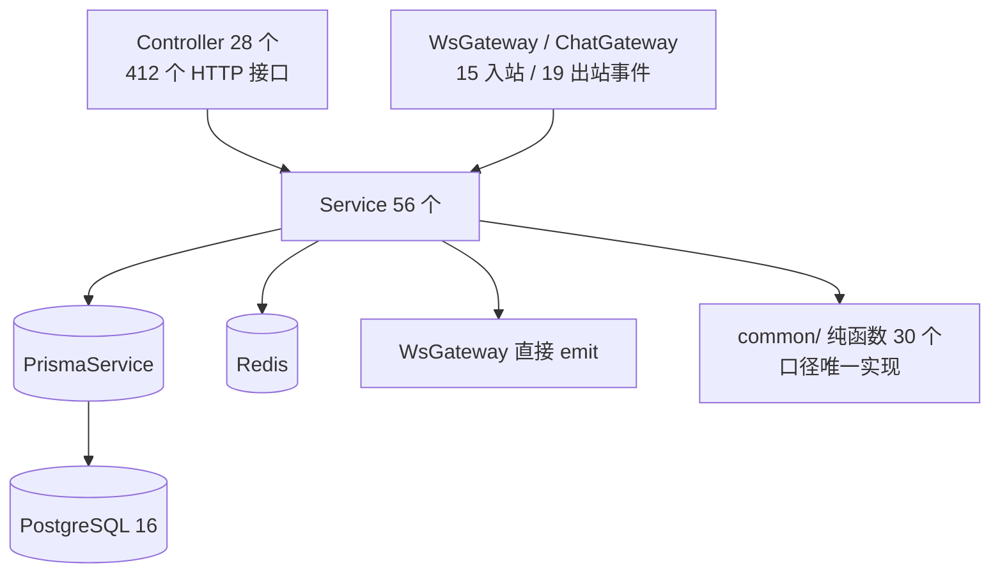
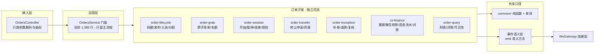
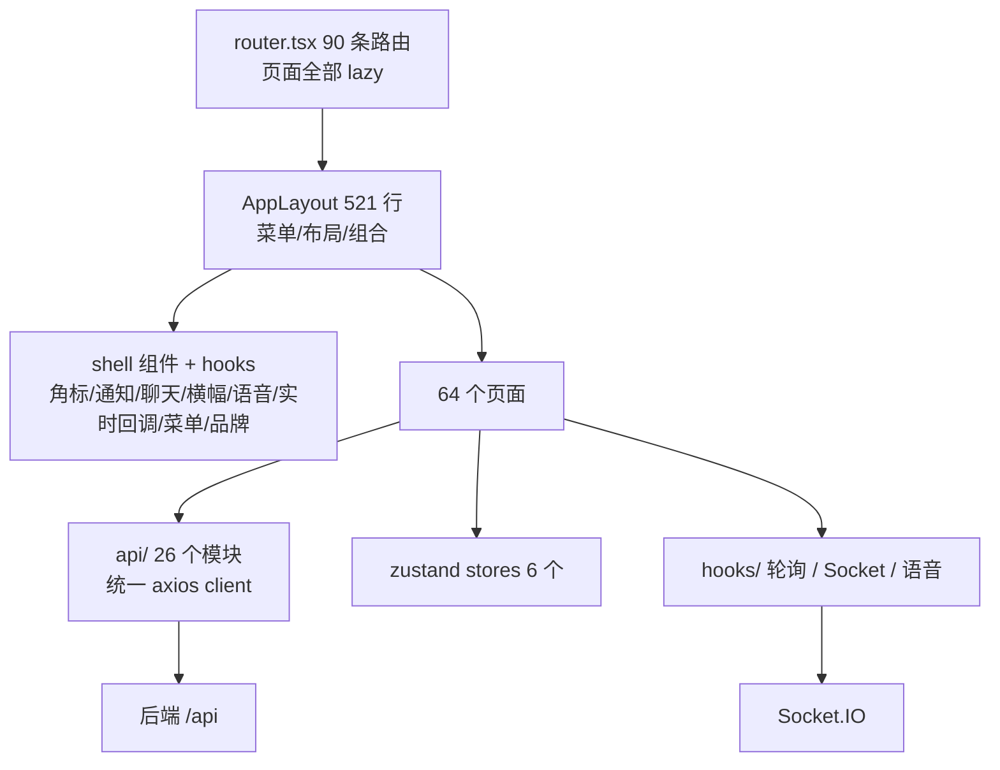

# 蠢驴电竞陪玩派单管理系统 — 平台重分析 / 目标设计（dev）

> 编写：2026-10-17（重构批次 25 起点）
> 分支：`dev`（`master` 始终保留可随时发布的线上版本）
> 配套：`docs/REFACTOR-PLAN.md`（问题诊断与批次进展）、`docs/API-CONTRACT.json`（对外契约）、`docs/WEB-ROUTES.json`（路由契约）
> 定位：本文是**结构与边界文档**，只回答「平台现在长什么样、要长成什么样、这一轮改了什么」。
> 按日期堆叠的变更流水一律留在 `CHANGELOG.md`，不再往架构文档里写。

---

## 0. 一页结论

这套系统的业务闭环已经完整（发单 → 抢单 → 服务计时 → 报账 → 结算 → 分润），线上有真实订单与真实资金在跑。
问题不在功能，而在三个「单点体积」和两个「重复实现」：

| 单点 | 现状（2026-10-17 批次 25–34 完成后实测） | 后果 |
|---|---|---|
| 后端订单服务 | `apps/server/src/orders/orders.service.ts` **549 行**（起点 4,787 → 4,244 → 1,385 → 549）；其余拆到 7 个子域服务 | 已从「上帝对象」降为「主流程 + 门面」；继续压缩空间已很小 |
| 前端外壳 | `apps/web/src/layouts/AppLayout.tsx` **521 行**（起点 2,543 → 2,055 → 895 → 521） | 菜单构建 / 样式注入 / 品牌版本 / 聊天 / 横幅 / 语音 / 角标 / 通知均已独立 |
| WebSocket 网关 | `apps/server/src/ws/ws.gateway.ts` **341 行**（起点 1,553 → 561 → 341）；连接 / 广播 / 黑名单 / 语音 / 状态 / 指令拆成 6 个服务 | 网关只剩入口与同名委托 |
| Socket 连接 | 前端 `useSocket` 已按 `baseUrl + namespace` 共享：同一账号物理连接 **3～4 条 → 1 条**（批次 25） | 心跳 / 重连 / 令牌续期各只跑一次 |
| 租户作用域 | `common/scope.ts` + **243 处** `scopeWhere` 调用（29 个文件）落地（批次 29/34）；裸 `studioId` 条件 **166 → 73** 并由 CI 冻结 | 「老板全站 / 本店 / 桥接店」有唯一实现；剩余 73 处均为非作用域写法 |

批次 25–34 覆盖五件「结构 + 工程地基」的事：
**订单子域化**、**外壳组件化**、**网关分层**、**配置中心类型化 + ScopeContext**、**antd 引入方式实验**；
并顺手修掉日期绑定测试与 lint 规则误报，让「全绿」重新成为可信基线。
antd 实验结论是**不做**：深路径引入后首屏反而 +2KB（详见第 5.8 节）。

---

## 1. 平台画像

### 1.1 四端一后台

| 端 | 载体 | 用户 | 技术形态 |
|---|---|---|---|
| 管理 / 租客 / 超管 | Web（也运行在客户端内） | 老板、店长、客服、陪玩 | React 18 + Ant Design 5 + Vite，**唯一一套前端** |
| 客服端 | Electron `apps/cs-electron` | 客服 | 外壳加载同一个远端 Web 应用；纯 JS |
| 陪玩端 | Electron `apps/companion-electron` | 陪玩 | 外壳加载同一个远端 Web 应用；TS + esbuild + 机器管控 |
| 看门狗 | Windows 服务 `apps/watchdog-service`（Go） | 每台机器 | 换文件 / 回滚 / 拉起，按 `--client` 区分身份 |
| 服务端 | Nest.js 10 + Prisma 5 + PostgreSQL 16 + Redis 7 | — | `apps/server`，`/api/*`，端口 3001 |

> 关键前提：**客服端 / 陪玩端不是两套前端**，它们只是两个 Electron 外壳，加载同一份远端 Web。
> 因此「网页端一改，四端同时生效」是最大的交付杠杆；反过来说，网页端的破坏性改动会同时打到四个端。

### 1.2 业务主链路（不变量）

```
发单（客服/店长/老板）
  ├─ 广播：Socket.IO 推送 → 陪玩端右下角横幅（秒级）
  └─ 入池：按段位 / 桥接 / 线上来源分段放行
        → 陪玩抢单（服务端原子条件写，先到先得，名额扣减可回滚）
        → 双陪单：指定 / 广播找搭档，被邀请方同意
        → 开始服务：会话计时、陪玩状态置 BUSY、按状态下发进程黑名单
        → 结束服务：时长、战报截图、客户、金额、报账
        → 结算：业绩入账 → 阶梯分润 → 可支取余额 → 提现/报账审核
```

横切口径：**每日 12:00 换营业日**（`common/business-day.ts`）；订单金额、时长、续单率、复购率、
黑名单、看板「今日」全部走同一套时间界线与 `common/` 纯函数。

### 1.3 规模基线（本轮起点实测）

| 指标 | 数值 |
|---|---|
| 服务端源码 | 171 个 `.ts`（不含测试/桩）/ 38,370 行 |
| 服务端结构 | 26 个模块 / 28 个 Controller / 56 个 Service |
| HTTP 接口 | **412 个**（`docs/API-CONTRACT.json`） |
| Socket 事件 | 入站 15 / 出站 19（字面量可静态扫描部分） |
| 服务端测试 | 90 个测试文件 / 848 条用例 |
| 前端源码 | 221 个文件 / 52,915 行 |
| 前端页面 | 64 个页面 `.tsx` + 70 个组件 `.tsx` |
| 路由 | 90 条（含重定向），`docs/WEB-ROUTES.json` 冻结 |
| 前端测试 | 22 个测试文件（2026-10-07 前为 0） |
| 共享包 | `packages/shared` 仅 4 个文件 / 159 行 |

---

## 2. 后端结构分析

### 2.1 运行时分层（现状）



**健康的部分**：`apps/server/src/common/` 是这块代码库里质量最高的一层 ——
营业日、可支取余额、分润、订单隐私、娱乐费判定、价格规则、客户续单率等都是纯函数 + 单测，
新逻辑应当继续往这里沉。

**不健康的部分**：`orders` 模块是事实上的「业务内核 + 上帝对象」：

| 文件 | 行数 | 说明 |
|---|---|---|
| `orders/orders.service.ts` | 4,244（重构前 4,787） | 公开方法 60+；发单、抢单、池、会话、转让、补单、退款、复核…… |
| `orders/cs-finance.service.ts` | 639（新增） | CS 微信收款 / 资金流水 / 对账子域（本批第一个样板） |
| `orders/orders.controller.ts` | 640 | 与 service 一对一转发，路由编排仍在膨胀 |
| `orders/` 目录 | 16 个文件 | 已有 6 个提醒服务、配额、工作流、派单服务、CS 收款子域 |
| `ws/ws.gateway.ts` | 1,448 | 握手/鉴权/房间/心跳 + 订单、聊天、黑名单、语音事件发射 |

### 2.2 领域边界（目标）



拆分手法（延续既有计划 6.2 节）：

1. **先建门面**：`OrdersService` 保留同名公开方法，方法体委托给子服务；Controller 与外部调用方零改动。
2. **先读后写**：只读查询 / 收款对账先拆；抢单、会话、结算等写路径最后动，且必须带事务与回归用例。
3. **口径下沉**：金额、时间窗、可见性判断继续搬进 `common/`，子服务只做编排。
4. **一个子域一次提交**：拆一个 → 跑全量测试 → 绿了再拆下一个。

### 2.3 已落地的订单子域

批次 25–31 已把订单服务拆成 **1 个主流程门面 + 7 个子域服务**：

| 子域 | 文件 | 行数 | 内容 |
|---|---|---|---|
| CS 收款 / 对账 | `orders/cs-finance.service.ts` | 639 | 客服微信收款、资金流水、对账、客服异常 |
| 补单 / 复核 | `orders/order-exception.service.ts` | 1,234 | 补单、退单、报结果、复核、催反馈 |
| 会话 / 搭档 | `orders/order-session.service.ts` | 730 | 开始 / 暂停 / 恢复 / 结束、搭档邀请、断线清理 |
| 转让 | `orders/order-transfer.service.ts` | 426 | 转让申请、同意 / 拒绝 / 撤回 / 过期 |
| 只读查询 | `orders/order-query.service.ts` | 746 | 抢单池、列表、详情、紧急单、待开始 |
| 创建 | `orders/order-create.service.ts` | 405 | 发单、号段生成、入池 / 派单 / 搭档初始化 |
| 客服操作 | `orders/order-cs.service.ts` | 577 | 联系跟进、加入房间、改单、抢单 / 释放、改金额 / 支付方式 |

七个子域都只依赖基础服务（Prisma / Ws / Bridge / Quota / Excellence / Session），**没有反向依赖 OrdersService、没有 forwardRef**；
`OrdersService` 保留同名门面，74 个类成员方法体与拆分前逐字节一致（1 处依赖委托改写），Controller / HTTP 路由零改动。
主文件从 4,787 → 549 行，继续拆分的收益已经很小。

---

## 3. 前端结构分析

### 3.1 运行时分层（现状）



已完成的工程化底座（2026-10-07 起）：

- 路由按页 `lazy` + 单一 `page()` 入口，入口分包从 1,205KB 降到 347KB；
- 设计令牌 `styles/tokens.ts` 唯一真源 + CSS 变量自动生成；硬编码色值从 1,271 处压到三百多；
- `PageHeader` / `StatCard` / `LoadingState` / `EmptyState` / `feedback.ts` 五个统一出口；
- 路由契约（90 条）、接口契约（412 个）、加载态 / 统计卡 / 反馈层 / 表格横滚 / 分包等守门脚本进 CI。

### 3.2 当前最重的三个点

| 问题 | 证据 | 影响 |
|---|---|---|
| 外壳巨型组件 | `AppLayout.tsx` 2,055 行（重构前 2,543）；本批已把 9 组角标与通知面板搬出，仍剩聊天 / 语音 / 横幅 | 改一个角标动全局文件；组件卸载/热更时定时器容易残留 |
| 轮询入口不统一 | 34 处裸 `setInterval`（其中一部分是计时器）、17 处 `visibleInterval/usePolling` | 看板类数据 15s/30s 轮询，状态变化感知慢；后台标签页仍有无效刷新风险 |
| Socket 连接重复 | 重构前 `useSocket` 4 个调用点各自 `io()`；同一账号 3～4 条连接、各自 30s 心跳。本批已收敛为按 `baseUrl + namespace` 的共享连接 | 连接数、心跳、重连、令牌刷新原本全部 ×N |

### 3.3 目标结构

```
apps/web/src/
  routes/            ← 路由表（path / roles / loader），菜单与路由同源
  layouts/AppLayout   ← 只做布局与组合（当前 895 行）
  components/shell/   ← 通知中心 / 聊天浮窗 / 横幅宿主 / 语音通话 / 提醒横幅
  hooks/              ← useMenuBadges / useShellChat / useShellBanners / useShellRealtime / useLiveRefresh / usePolling / useVoiceCall
  sockets/            ← 单连接 + 事件语义封装（按 token 共享）
  api/                ← 唯一数据出口（禁止页面里直接 axios/fetch）
  stores/             ← 跨页状态（auth / chat / notice / order / invite）
  pages/              ← 页面只关心自己的数据与交互
  styles/             ← tokens.ts 唯一颜色/间距来源
```

数据流原则：

1. **推送优先、轮询兜底**：状态变化、抢单、转让、会话开始/结束走 Socket 事件；
   轮询只在「事件可能丢」时做兜底，并且必须可见性感知、节流合并。
2. **单一连接**：整个标签页只有一条 Socket.IO 连接；每个 hook 只注册自己的回调并成对清理。
3. **页面不直连网络**：所有请求经 `api/`；错误统一走 `feedback.ts` 去重出口。
4. **口径不在前端重算**：金额/时长/续单率等以后端返回为准，前端只格式化。

---

## 4. 重构设计（批次 25–30）

### 4.1 范围与不变量

| 必须保留 | 说明 |
|---|---|
| 412 个接口路径 / 字段 | `docs/API-CONTRACT.json` 冻结，CI 校验 |
| 90 条前端路由 | `docs/WEB-ROUTES.json` 冻结，CI 校验 |
| Socket 事件名 / payload 语义 | 只增加「谁触发刷新」，不改事件契约 |
| 所有页面功能与交互 | 本轮是结构重构，视觉与点击行为零变化（实时看板只增强刷新即时性） |
| 业务口径 | 营业日、金额、权限判断原样，不顺手改业务 |

### 4.2 交付拆分

| # | 方向 | 内容 | 验收 |
|---|---|---|---|
| 25-1 | 后端 | `orders.service.ts` 迁出 CS 微信收款 / 资金流水 / 对账 → `orders/cs-finance.service.ts`，门面委托 | 类型检查、全量服务端测试、build 全绿；文件行数下降 |
| 25-2 | 前端外壳 | `AppLayout` 迁出 9 组菜单角标 → `hooks/useMenuBadges.ts`；通知面板 → `components/shell/NotificationPanel.tsx` | 前端类型检查、测试全绿；AppLayout 显著变短 |
| 25-3 | 前端实时 | `useSocket` 收敛为按 token 单连接；新增 `useLiveRefresh` 节流刷新；实时看板 / 客户看板推送驱动 + 轮询兜底 | 类型检查、测试全绿；连接数与心跳不再 ×N |
| 25-4 | 基线 | 修掉 `stats.daily-kpi.test.ts` 与系统日期绑定的断言（改为按当天推算） | 单测绿；全量服务端测试回到 848/848 |
| 26 | 后端 | `orders.service.ts` 继续拆补单复核 / 会话搭档 / 转让 / 查询子域，目标 < 1,500 行 | 1,385 行；服务端 93/910 全绿 |
| 27 | 前端外壳 | `AppLayout` 拆聊天浮窗 / 横幅宿主 / 语音通话 / 实时回调，目标 < 1,200 行 | 895 行；web 27/164 全绿 |
| 28 | 后端实时 | `ws.gateway` 拆连接层 / 广播层 / 黑名单层 / 语音层，公开 API 不变 | 1,553 → 561 行；ws 测试 + 全量 93/910 |
| 29 | 后端地基 | 118 个配置键类型化 + 写入校验 + 单入口；`ScopeContext` 迁移核心读路径 | 配置/作用域测试 60 条；裸 `studioId` 166 冻结、目标目录 37→10 |
| 30 | 前端实验 | `antd/es/*` 按组件引入，量首屏收益 | **结论不做**：首屏 1,870 → 1,872KB（gzip 593 → 593），无收益 |
| 31 | 后端订单 | 再抽创建 / 客服订单操作子域 | 1,385 → **549 行**；服务端 93/914 |
| 32 | 前端外壳 | 再抽样式注入 / 菜单构建 / 品牌版本逻辑 | 895 → **521 行**；web 27/164 |
| 33 | 后端实时 | 再抽 companion:status / pc:command_ack / chat:send | 561 → **341 行**；公开 API 45/45、emit 10/10、订阅 12/12 不变 |
| 34 | 后端作用域 | 继续迁移非订单目录裸 studioId | **166 → 73**；基线调低；服务端 93/914 |

### 4.3 验收门禁（全绿才算完）

```bash
pnpm -r typecheck
pnpm --filter @chunlv/server test
pnpm --filter @chunlv/web test
pnpm --filter @chunlv/server build
pnpm --filter @chunlv/web build
pnpm -r lint
node scripts/_check_ui_tokens.mjs --check
node scripts/_check_loading_state.mjs --check
node scripts/_check_stat_cards.mjs --check
node scripts/_check_feedback_layer.mjs --check
node scripts/_check_table_scroll.mjs --check
node scripts/_check_route_splitting.mjs
node scripts/_export_web_routes.mjs --check
node scripts/_export_api_contract.mjs --check
```

---

## 5. 批次 25–34 交付记录（滚动更新）

> 详细提交与验证证据见 `CHANGELOG.md` 与 `docs/REFACTOR-PLAN.md` 的「第 25–34 批」。

### 5.1 结构变化（批次 25，可复算）

| 对象 | 重构前 | 重构后 | 变化 |
|---|---|---|---|
| `apps/server/src/orders/orders.service.ts` | 4,787 行 | 4,244 行 | **-543**（CS 收款 / 资金流水 / 对账整段迁出） |
| `apps/server/src/orders/cs-finance.service.ts` | 不存在 | 639 行 | 新增子域服务（11 个方法 + 2 个私有 helper，方法体逐字节一致） |
| `apps/web/src/layouts/AppLayout.tsx` | 2,543 行 | 2,055 行 | **-488**（9 组角标 + 通知面板 + 提醒横幅迁出） |
| `apps/web/src/hooks/useMenuBadges.ts` | 不存在 | 495 行 | 新增外壳角标 hook（间隔 / 可见性 / seen 记账原样） |
| `apps/web/src/components/shell/` | 不存在 | 2 个组件 / 235 行 | `NotificationPanel` + `NoticePathBanner` |
| `apps/web/src/hooks/useSocket.ts` | 454 行、每次调用新建连接 | 567 行、按 `baseUrl + namespace` 共享连接 | 同一账号物理连接 **3～4 条 → 1 条**；心跳定时器 **3～4 个 → 1 个** |
| `apps/web/src/hooks/useLiveRefresh.ts` | 不存在 | 161 行 | 新增推送驱动刷新（500～1000ms 合并、不并发、不可见暂停） |
| `eslint.config.mjs` | `.ts` 里的 react-hooks disable 注释报 error | 插件注册到全部 TS 文件 | `pnpm -r lint` 回到 **0 error** |

### 5.2 行为等价 / 增强点

- **零接口变化**：412 个 HTTP 接口、15 个入站事件、19 个出站事件与重构前逐条一致（契约脚本比对通过）。
- **零路由变化**：90 条前端路由与重构前一致。
- **零功能删减**：AppLayout 的 9 组角标、通知面板、提醒横幅、菜单角标计数、点过就消的记账全部保留；
  后端 11 个公开方法签名与返回不变，Controller 未改。
- **交互增强**：实时看板 / 客户看板从「最快 15 秒才看到变化」变为「事件到达约 0.8～1 秒刷新」，
  断线 / 漏事件仍有 15 秒轮询兜底；页面切到后台不再空转刷新，回前台立即补一次。
- **性能增强**：同一账号只保留一条底层 WebSocket；心跳、重连、令牌刷新、顶号处理各只执行一次。

### 5.3 验证结果（批次 34 结束时）

| 门禁 | 结果 |
|---|---|
| `pnpm -r typecheck` | 通过 |
| 服务端测试 | **93 文件 / 914 用例全绿**（含配置中心 36 + ScopeContext 24 + ws 委托 6 + 其他批次新增） |
| 前端测试 | **27 文件 / 164 用例全绿**（含 Socket 单连接 7 条回归 + 变异验证） |
| `pnpm -r lint` | **0 error**（警告为历史积压） |
| `pnpm --filter @chunlv/server build` | 通过 |
| `pnpm --filter @chunlv/web build` | 通过；入口分包与首屏见 `_check_route_splitting` 输出（上限 512KB / 2,000KB·640KB） |
| 契约 / 路由 / 令牌 / 加载态 / 统计卡 / 反馈层 / 表格横滚 / CSS 变量 / 作用域 | 全部通过（ui-tokens 332 / loading 0 / stat-cards 0 / feedback 0 / table-scroll 0 / routes 90 / css-vars 94 / contract 412·15·19 / scope 73） |

### 5.4 批次 26–34 结构变化

| 对象 | 起点 | 现在 | 变化 |
|---|---|---|---|
| `orders/orders.service.ts` | 4,244 行 | **549 行** | 拆出 exception / session / transfer / query / create / cs 六个子域 + 共享常量 |
| `orders/` 子域服务 | 1 个（cs-finance） | 7 个，共 4,757 行 | 74 个类成员方法体逐字节迁出、无循环依赖 |
| `AppLayout.tsx` | 2,055 行 | **521 行** | 拆出 3 个 shell 组件 + 5 个 shell hook + 样式注入模块 |
| `components/shell/` + `hooks/useShell*` | 2 个组件 / 235 行 | 5 个组件 + 6 个 hook | 新增聊天浮窗、横幅宿主、语音通话、菜单构建、品牌版本、实时回调 |
| `ws/ws.gateway.ts` | 1,553 行 | **341 行** | 拆出连接 / 广播 / 黑名单 / 语音 / 状态 / 指令 6 个服务 |
| 配置中心 | 118 个键散装字符串 | `common/config-keys.ts`（836 行） | as const 键表 + 类型 / 默认值 / 作用域 / 校验器；写入统一校验 |
| 作用域 | 661 处裸条件、无统一入口 | `common/scope.ts` + **73** 基线 | **243 处** `scopeWhere` 调用（29 文件）；裸条件 166→73，CI 冻结 |
| antd 引入 | `import { X } from 'antd'` | **保持不改** | 深路径实验：首屏 1,870→1,872KB（+2KB），收益为零 |

### 5.5 已知风险与收尾

- 共享连接在 SPA 内「不刷新页面直接换账号」时不会被重建；当前登出 / 顶号路径都是整页跳转，没有这条路径。
- 每个 `useSocket` 消费者仍注册整套事件包装（旧契约允许运行时替换回调）；多消费者时是几次 no-op 判断，开销可忽略。
- `orders` / `ws` / `AppLayout` 都采用「可选参数 + 兜底实例」写法保证老单测可手写 `new`；生产环境仍由 Nest DI 注入，
  建议部署前在测试环境实启一次服务确认 DI（本地只能 typecheck + 单测）。
- 作用域剩余 73 处均为**刻意保留**的非作用域写法（写操作按 id 精确匹配、复合唯一键、关系筛选、显式 `OR` 口径、
  orders 21 / ws 5 并行任务域等），不是漏迁；由 CI 冻结只减不增。
- 本批只在 `dev` 分支；未部署、未发客户端。`master` 仍保持可随时发布的线上版本。

---

## 6. 后续路线（按性价比排序）

| 优先级 | 任务 | 状态 / 目标 | 依赖 |
|---|---|---|---|
| P1 | `orders` 继续拆 | **已完成**（549 行，7 子域） | — |
| P1 | `AppLayout` 继续拆 | **已完成**（521 行） | — |
| P1 | `ws.gateway` 剩余业务订阅 | **已完成**（341 行，6 服务） | — |
| P2 | 作用域继续迁移剩余裸 `studioId` | **阶段性完成**（166→73，CI 冻结） | — |
| P2 | 配置中心前端表单与 schema 联动 | 待做；当前只做后端校验 | 29 |
| P2 | antd 首屏优化（替代方案） | 实验已证伪深路径引入；下一步考虑首屏页面拆分 / antd 版本 | 30 结论 |
| P3 | `DataTable` 统一三大表列配置 | 待做；列宽属于业务取舍，需老板确认可收起列 | 页面临近 |
| P3 | 双客户端机器端能力收敛为共享包 | 待做；涉及终端发版，必须请示 | 客户端窗口 |

> 红线：任何涉及**终端程序更新**的动作先请示；任何脚本不得改 `blacklist.enabled` 等线上业务开关；
> 线上真实客户 / 订单 / 报账数据只读；测试数据必须自己收尾删除。
